# Explanatory figures (updated 16 October 2026)

Drawn by experiments/make_explanatory_figures.py from the repository's own outputs (graph tables, summaries and run
results), so each figure can be regenerated after the inputs change; a figure whose inputs are absent is skipped with a
message and keeps its last drawing. Figures 1 to 3 and 7 to 12 read the v5 tables and the graph the registered model
reads with them, `graph_full_neuronal_split_binders_drugs_v5`. Figures 5 and 6 are the monogenic slice pilot's, drawn
from its runs of 8 October 2026, and are unchanged since. No figure reads a lockbox output, and no full-graph model has
been scored.

## 1. The model

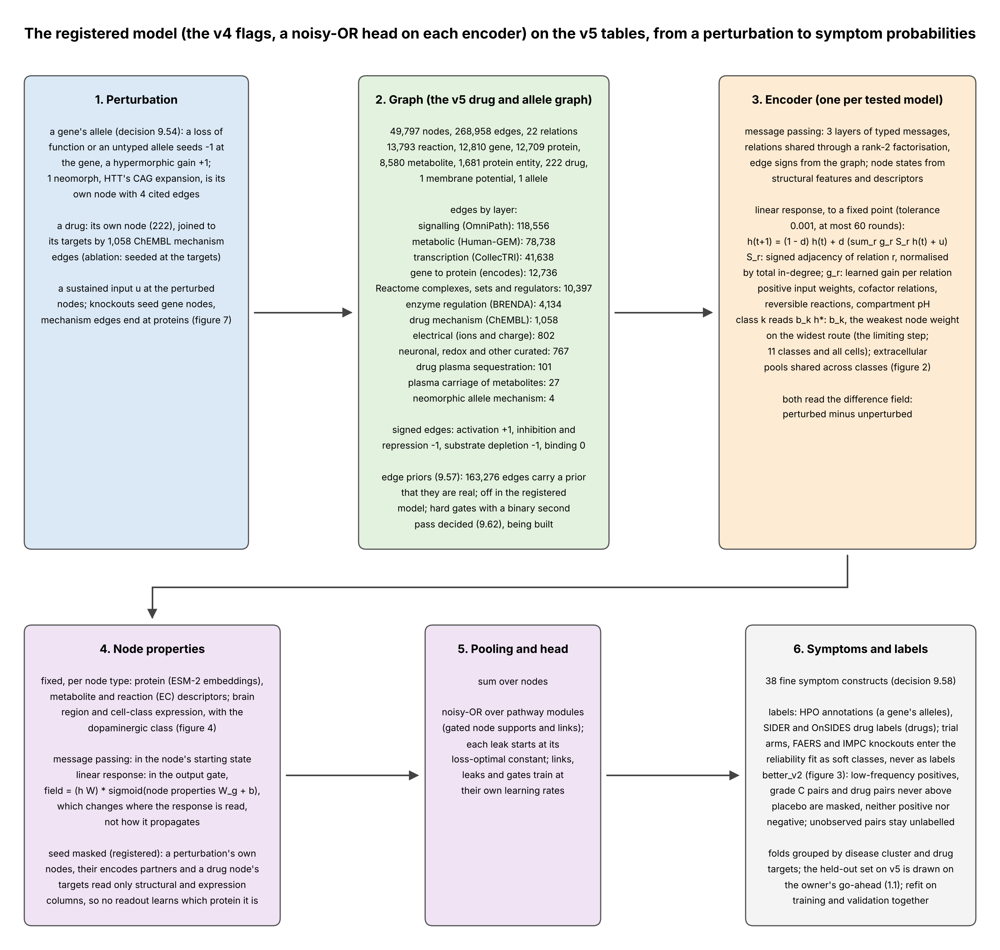

The registered model (the v4 flags of `experiments/run_main_model_batch.py`, which the trainer's defaults equal; the
owner, 13 October 2026: "all of the v4 stuff should be ON by default") with a noisy-OR head on each of the two
encoders, on the v5 tables. A perturbation is an allele of a gene or a drug. Since decision 9.54 a gene's loss of
function and its gains are separate perturbations: a loss of function or an untyped allele seeds -1 at the gene, a
hypermorphic gain +1, and HTT's CAG expansion is a node of its own with four cited edges (figure 11). A drug is a node
of its own, joined to its targets by its ChEMBL mechanism edges, with an ablation arm that seeds the targets instead
(the user, 10 October 2026). The message-passing encoder runs 3 layers of typed messages with the relations shared
through a rank-2 factorisation. The linear-response encoder propagates to a fixed point (tolerance 0.001, at most 60
rounds) over the signed adjacency of each relation normalised by total in-degree, with a learned gain per relation,
positive input weights, cofactor relations, reversible reactions and compartment pH; each cell class reads the settled
state scaled by its limiting step (figure 2). Both read the difference field. The node descriptors are read under the
registered seed masking, so a perturbation's own nodes, their encodes partners and a drug node's targets read only
their structural and expression columns. Labels are better_v2 on the 38 fine constructs (figure 3); trial arms, FAERS
and IMPC knockouts enter the reliability fit as soft classes and never as labels (decision 9.48). Folds are grouped by
disease cluster and drug targets; the held-out set on v5 is drawn on the owner's go-ahead (decision 1.1). The edge
priors of decision 9.57 are built and off in the registered model; the hard gates of decision 9.62 are being built
(figure 12). Every count is read from the graph and the summaries when the figure is drawn.

## 2. Cell-class channels

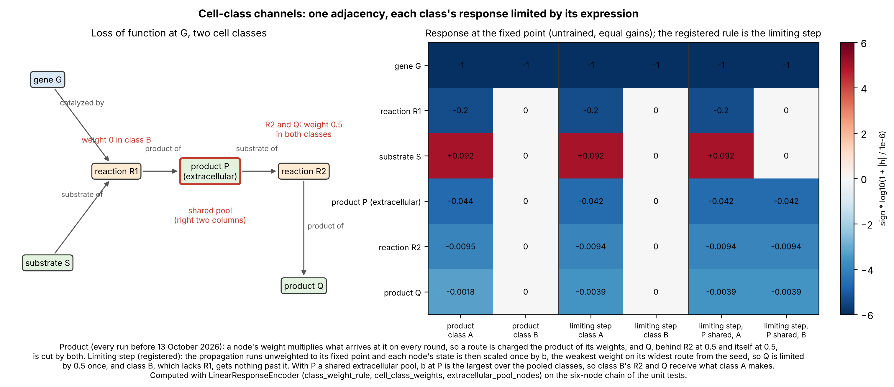

How cell types enter without copying the graph, under the two rules the encoder has. On a six-node chain with equal
gains, class B does not express reaction R1, and R2 and Q are at half their highest class in both classes. Under the
product rule, which every run before 13 October 2026 used, a node's weight multiplies what arrives at it on every
round, so a route is charged the product of its weights and Q, behind R2 at 0.5 and itself at 0.5, is cut by both
(-0.0018). Under the limiting step, the registered rule (the owner, 13 October 2026: "min along the path makes WAY more
sense to me. do that so it aligns with the physiology"), the propagation runs unweighted to its fixed point and each
node's state is scaled once by b, the weakest weight on its widest route from the seed, so Q is limited by 0.5 once
(-0.0039). Class B, which lacks R1, gets nothing past it under either rule. Marking P as a shared extracellular pool
makes b at P the largest over the pooled classes, so class B's R2 and Q receive what class A makes. The values are
computed by LinearResponseEncoder itself, untrained. The weights are a node's expression relative to its highest
class, x_k / (max_j x_j + 1 nCPM) (mechanistic_pathway_learning/graph/brain_expression_weights.py).

## 3. Better (not more) training examples

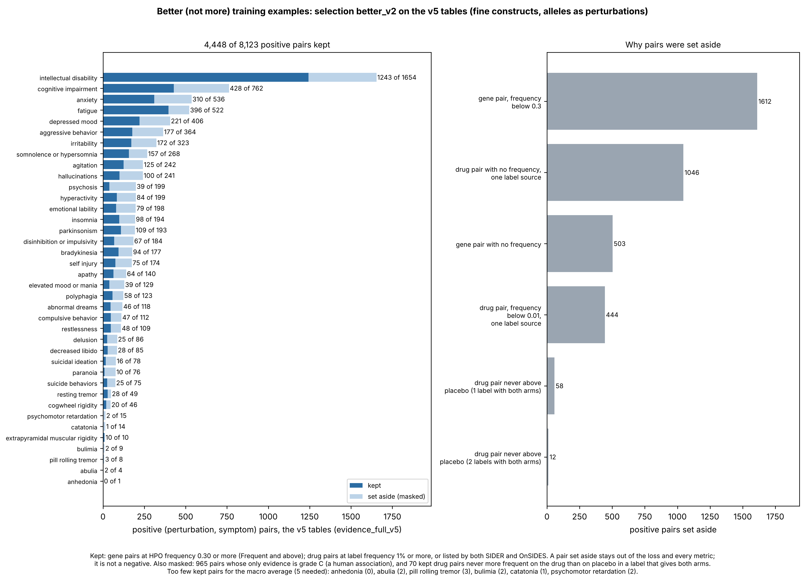

The better_v2 selection on the v5 tables: 38 fine constructs (decision 9.58) and the allele perturbations (decision
9.54). Gene pairs are kept at HPO frequency 0.30 or more; drug pairs at label frequency 1 percent or more or when both
SIDER and OnSIDES list them. 4,448 of 8,123 positive pairs are kept. A pair set aside is masked out of the loss and
every metric; it is not a negative. Also masked are the pairs whose only evidence is grade C (a human association) and
the kept drug pairs never more frequent on the drug than on placebo in a label that gives both arms (70 on v5).
Intellectual disability is the largest construct by far, 1,243 kept pairs (decision 9.61 is about it). Anhedonia,
abulia, pill-rolling tremor, bulimia, catatonia and psychomotor retardation keep fewer than the 5 positives the macro
average needs.

## 4. The dopaminergic class

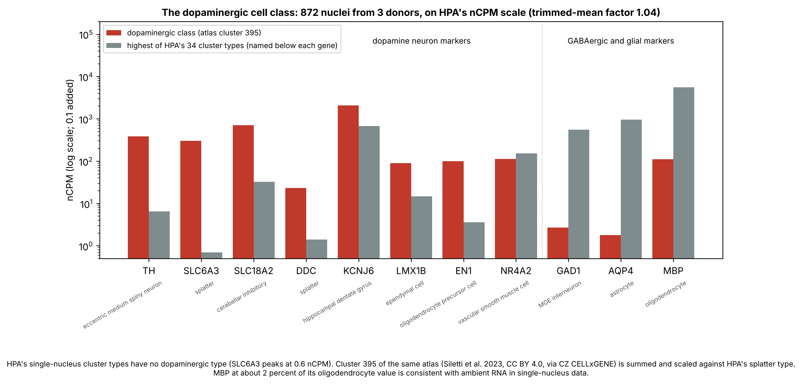

The Human Protein Atlas single-nucleus cluster types have no dopaminergic type, so dopamine neuron markers peak at a
few nCPM in unrelated types (SLC6A3 at 0.6 in splatter neurons). Cluster 395 of the same atlas (Siletti et al. 2023),
summed from 872 nuclei and scaled to HPA's nCPM with a trimmed mean of log ratios, carries TH, SLC6A3 and SLC18A2 at
hundreds of nCPM and GAD1 and AQP4 below 3. Data: CC BY 4.0 (Siletti et al. 2023, via CZ CELLxGENE) and HPA
(CC BY-SA 4.0).

## 5. Slice pilot: one-change comparisons

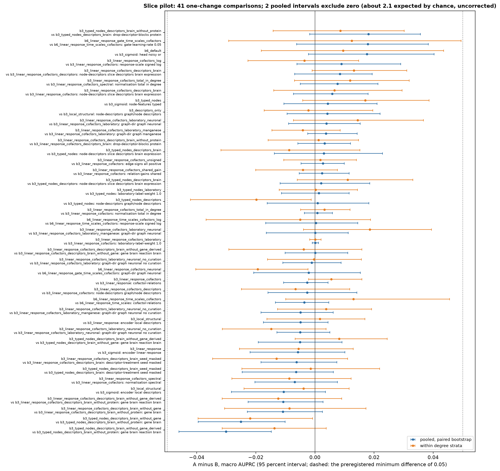

Every two slice configurations that differ in one argument, both with five finished folds (41 pairs, regenerated on
8 October with the brain-expression descriptor arms and their treatments), read two ways: the pooled out-of-fold
difference in macro AUPRC with a paired bootstrap, and the same after ranking scores inside each degree stratum of
each fold. Dashed lines mark the preregistered minimum difference of 0.05; no interval reaches it. Two pooled intervals
exclude zero, about the 2.1 that 41 uncorrected intervals give by chance, and both are message-passing descriptor
blocks: dropping the gene block scores below dropping the protein block, -0.025 [-0.040, -0.010], and dropping the
gene-derived reaction block scores below it too, -0.030 [-0.046, -0.015]. Three within-strata intervals exclude zero (descriptors in message passing,
-0.020; the same gene-against-protein pair, -0.022; the neuronal graph under the noisy-OR head, -0.019).
docs/twin_comparisons.md has the numbers. The module-fix and gene-and-protein-split arms (runs/module_fix) are read in
docs/module_health_results.md, docs/module_health_fast_leak_results.md and, when split_slice ends, its own document.

## 6. Slice pilot: baselines and models

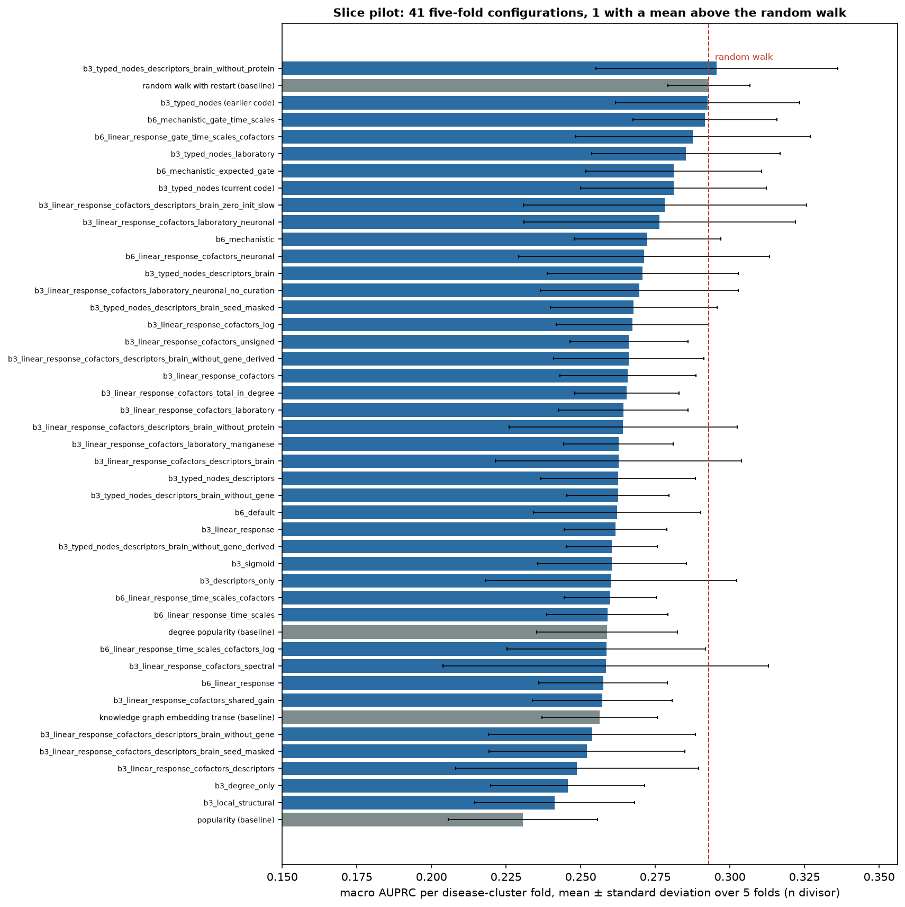

Per-fold macro AUPRC of the four slice baselines and every five-fold slice configuration of runs/phase3_aggregate.json
(41 configurations). One configuration has a mean above the random walk's 0.293: b3_typed_nodes_descriptors_brain_without_protein
at 0.296, with a fold standard deviation of 0.041 against the walk's 0.014, which no paired comparison has tested. The
amendment of 7 October attributes the trained models' position to the slice's size and single layer rather than to the
mechanism; the slice cannot tell those two apart. b3_typed_nodes appears twice: the earlier run and the rerun under
the current code (runs/encoder/).

## 7. Gene and protein nodes

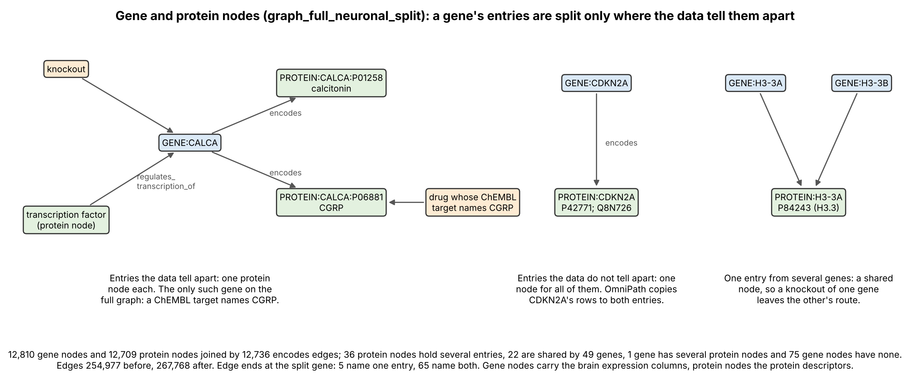

graph_full_neuronal_split (docs/gene_protein_split.md, with the correction of 8 October on complex accessions). Each
gene node joins its protein node by an encodes edge. A gene's reviewed UniProt entries get separate protein nodes only
where the data tell them apart; on the full graph that is CALCA alone, because a ChEMBL target names CGRP (P06881) and
not calcitonin (P01258). CDKN2A keeps one node for both entries, since OmniPath copies its rows to each. Entries shared
by several genes (H3-3A and H3-3B for H3.3) get one shared node, so a knockout of one gene leaves the other's route.
Knockouts seed gene nodes, drugs seed protein nodes and transcription edges end at genes. Gene nodes carry the brain
expression columns and protein nodes the protein descriptors. Counts are read from split_summary.json when the figure
is drawn.

## 8. Plasma carriage

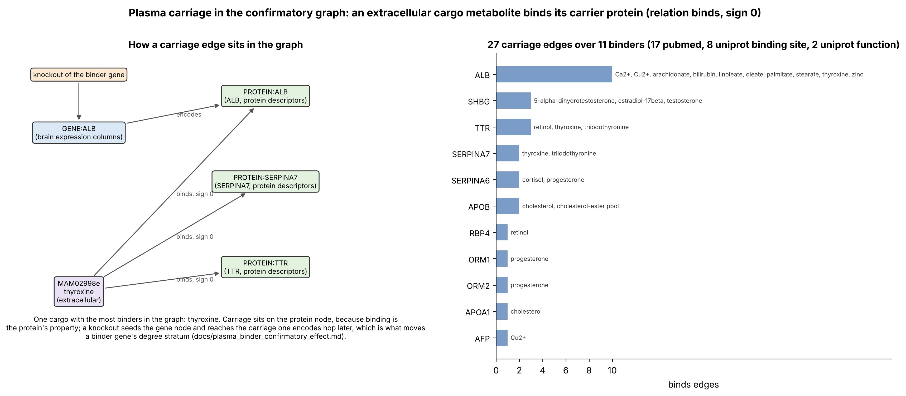

The 27 `binds` edges of graph_full_neuronal_split_binders (docs/plasma_binder_graph.md), which carry an extracellular
cargo metabolite to the plasma protein that binds it: 19 cargo metabolites over 11 binders, sign 0, from the curated
carriage table (docs/curated_plasma_carriage.csv, each row with a PMID, a DOI and a quoted sentence) and from UniProt
binding-site features. The carriage sits on the protein node, because binding is the protein's property, so no
perturbation's own seed node is touched; a knockout of a binder gene reaches the carriage one `encodes` hop later,
which is why three binder genes that are perturbations change strata degree and two of them, both development rows,
move degree quintile (docs/plasma_binder_confirmatory_effect.md). The left panel takes the cargo with the most binders
in the graph; the right panel counts the edges of each binder and names its cargo. Orosomucoid (ORM1, ORM2) gets one
edge each, progesterone, and not because the rest was missed: its cargo is basic drugs, which this graph has no node
for, so it enters through the fraction unbound of stage 2 (docs/plasma_protein_binding.md) rather than through these
edges.

## 9. The cell state the model carries

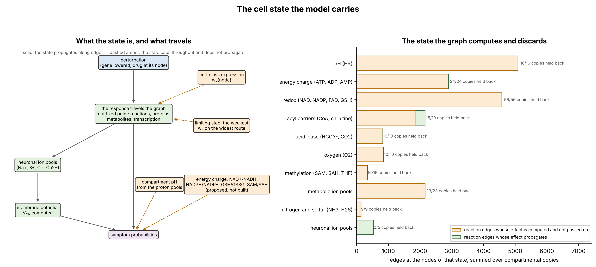

What a node's state is and which parts of it travel: the response propagates along edges to a fixed point, while the
cell-class expression, the limiting step and the compartment pH cap throughput and do not propagate. The right panel
counts, on the v5 graph, the reaction edges at the nodes of each piece of cell state whose effect is computed and not
passed on (the currency copies) against those whose effect propagates. `docs/cell_state_representation.md` carries
the argument.

## 10. The graph

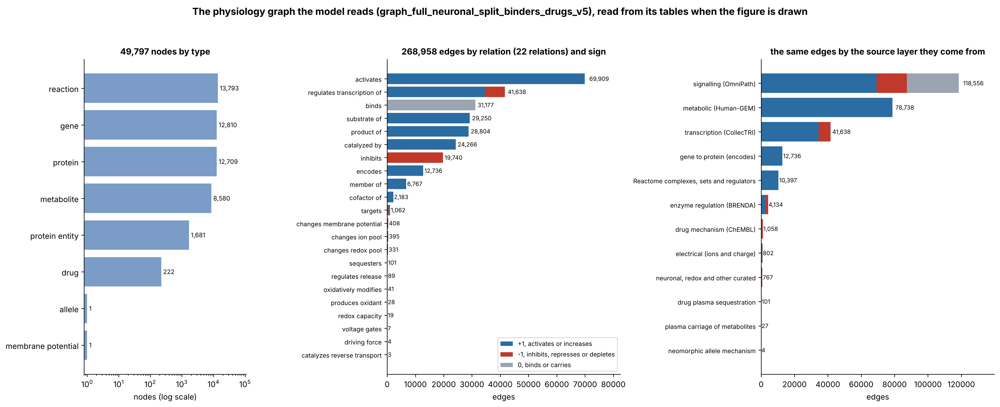

`graph_full_neuronal_split_binders_drugs_v5`: 49,797 nodes in eight types and 268,958 edges in 22 relations, by sign,
and the same edges by the source layer they come from (OmniPath signalling, Human-GEM metabolism, CollecTRI
transcription, the gene-to-protein split, Reactome complexes and sets, BRENDA enzyme regulation, the drug mechanism and
sequestration edges, the electrical edges, the curated neuronal and redox edges, plasma carriage and the allele's
edges). `docs/graph_summary.md` gives the same counts as tables.

## 11. Alleles as perturbations

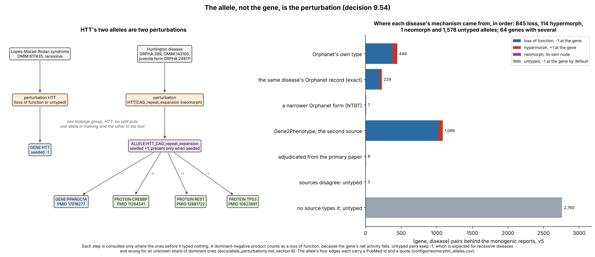

Decision 9.54 (d), built 16 October 2026 (`docs/allele_perturbations.md`). Left: HTT's recessive allele (OMIM:617435)
is the perturbation HTT, seeded -1 at the gene; Huntington disease is the perturbation of the CAG expansion, seeded on
its own node, whose four edges each carry a PubMed id and a quote; both are in one leakage group. Right: the 4,537
(gene, disease) pairs behind the monogenic reports, by the step that typed each one's mechanism, in order: Orphanet's
own type, the same disease's other record, a narrower Orphanet form, Gene2Phenotype, an adjudication from the primary
paper; 3 pairs whose sources disagree and 2,760 that no source types stay untyped and keep -1.

## 12. Edge priors and hard gates

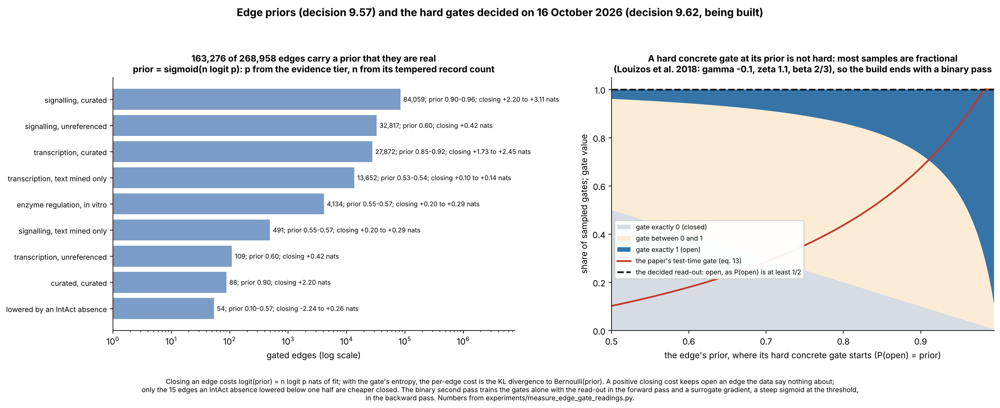

Left: the 163,276 gated edges of the v5 graph by evidence tier, with the prior that each is real in the form decided on
16 October 2026, sigmoid(n logit p), and the cost of closing it, n logit p nats (decision 9.62). Only the 15 edges an
IntAct absence lowered below one half are cheaper closed. Right: a hard concrete gate (Louizos et al. 2018) started at
its prior is mostly fractional, and the paper's test-time gate reads a 0.9 edge as 0.67; that is why the decided build
ends with a binary pass, which trains the gates alone with the read-out (open when P(open) is at least one half) in the
forward pass and a surrogate gradient in the backward pass.

## How they are drawn

Every figure is saved at 240 dpi (150 until 9 October 2026, which left the dense pipeline figure soft). Figure 1 is
laid out in inches: each box is sized from its own measured title and body, the two rows share one left and right
edge with the slack spread into the gaps, and the step from the encoder to the node properties is routed through the
gutter between the rows. It was one diagonal across the whole figure until 9 October 2026, which read as an error.
Figure 2's toy and its numbers are computed by the encoder each time the figure is drawn, so a change to the encoder
shows in the figure.
